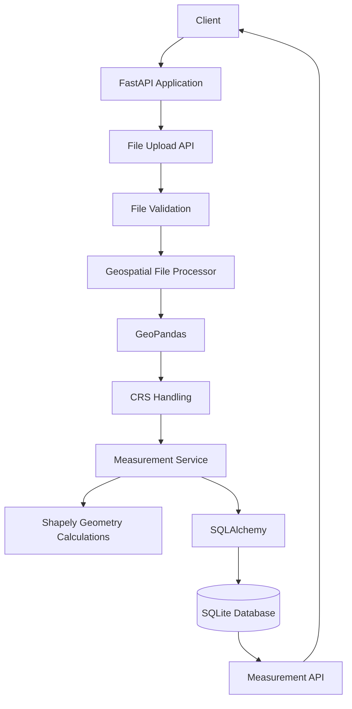

# 🌍 Geospatial File Measurement API

> A FastAPI-based backend that allows users to upload geospatial files, process spatial features, handle Coordinate Reference Systems (CRS), and automatically calculate geometric measurements such as area and length.

---

## 📌 Project Overview

The **Geospatial File Measurement API** is a backend application developed using **FastAPI, GeoPandas, Shapely, PyProj, and SQLite**.

The API accepts geospatial files such as **Shapefiles packaged inside ZIP files and KML files**, extracts and processes their spatial features, identifies geometry types, handles coordinate reference systems, and calculates appropriate measurements.

For example:

* **Polygon → Area**
* **LineString → Length**
* **Point → No area/length measurement**
* **Unsupported geometries → Graceful message**

The processed information is stored in a SQLite database and can be retrieved through REST API endpoints.

---

## 🎯 Problem Statement

Geospatial files contain important spatial information such as:

* Geometry
* Feature attributes
* Coordinate Reference System (CRS)
* Spatial feature types

However, calculating accurate measurements directly from geographic coordinates can be challenging because latitude and longitude are angular units rather than standard linear measurement units.

The goal of this project is to build an API that can:

1. Accept geospatial files.
2. Extract spatial features.
3. Identify geometry types.
4. Handle CRS correctly.
5. Transform geographic coordinates into a suitable projected CRS.
6. Calculate area and length.
7. Store processed results.
8. Provide the results through REST API endpoints.

---

## 💡 Proposed Solution

The application provides a simple REST API where users can upload a supported geospatial file.

The backend then:

```text
Upload File
     ↓
Validate File Type
     ↓
Extract / Read Geospatial Data
     ↓
Identify CRS
     ↓
Transform Geographic CRS if Required
     ↓
Identify Geometry Type
     ↓
Calculate Area / Length
     ↓
Store Results in Database
     ↓
Return API Response
```

This creates a reusable backend service for basic geospatial file processing and measurement.

---

## ✨ Key Features

* 📤 Upload `.zip` and `.kml` files
* 🗺️ Read Shapefiles using GeoPandas
* 📍 Process Polygon, LineString and Point geometries
* 📐 Calculate polygon area
* 📏 Calculate line length
* 🌍 Handle geographic CRS such as EPSG:4326
* 🔄 Automatically transform geographic CRS to a suitable projected CRS
* 💾 Store file and measurement information in SQLite
* 🔎 Retrieve uploaded file information
* 📊 Retrieve feature-level measurements
* 🛡️ Validate unsupported file types
* 🔐 Prevent unsafe ZIP extraction paths
* ⚠️ Gracefully handle unsupported geometries
* 🧪 Includes automated unit tests
* 📚 Interactive Swagger API documentation

---

## 🛠️ Technologies Used

| Technology          | Purpose                    |
| ------------------- | -------------------------- |
| **Python**          | Backend programming        |
| **FastAPI**         | REST API framework         |
| **GeoPandas**       | Geospatial file processing |
| **Shapely**         | Geometry operations        |
| **PyProj**          | CRS transformation         |
| **Fiona / Pyogrio** | Geospatial file reading    |
| **SQLAlchemy**      | Database ORM               |
| **SQLite**          | Data storage               |
| **Uvicorn**         | ASGI server                |
| **Unittest**        | Automated testing          |

---

## 🏗️ System Architecture



---

## 🔄 Processing Workflow

### Step 1 — File Upload

The client sends a geospatial file through:

```http
POST /api/files/
```

Supported formats:

```text
.zip
.kml
```

---

### Step 2 — File Validation

The backend checks the uploaded file extension.

Unsupported files are rejected with a `400 Bad Request`.

Example:

```json
{
  "detail": "Only .zip and .kml files are supported."
}
```

---

### Step 3 — Geospatial Processing

For KML files, GeoPandas reads the KML directly.

For ZIP files:

```text
ZIP
 ↓
Extract to temporary directory
 ↓
Search for .shp file
 ↓
Read Shapefile using GeoPandas
```

The application also validates ZIP paths to prevent unsafe extraction outside the temporary directory.

---

### Step 4 — CRS Handling

The application checks the Coordinate Reference System of the uploaded data.

If the data uses a geographic CRS such as:

```text
EPSG:4326
```

the coordinates are transformed into a suitable projected CRS before performing measurements.

This is important because area and length calculations should be performed using projected coordinates rather than directly using latitude/longitude degrees.

The application uses GeoPandas to estimate a suitable UTM CRS automatically.

---

### Step 5 — Geometry Identification

Each feature is inspected individually.

Supported geometry types include:

```text
Polygon
MultiPolygon
LineString
MultiLineString
Point
MultiPoint
```

---

### Step 6 — Measurement Calculation

| Geometry        | Measurement                  |
| --------------- | ---------------------------- |
| Polygon         | Area                         |
| MultiPolygon    | Area                         |
| LineString      | Length                       |
| MultiLineString | Length                       |
| Point           | No measurement               |
| MultiPoint      | No measurement               |
| Other           | Graceful unsupported message |

---

### Step 7 — Database Storage

The application stores:

* File information
* Feature count
* CRS
* Processing status
* Feature ID
* Geometry type
* Feature properties
* Geometry representation
* Area
* Length
* Processing messages

---

## 📐 Measurement Logic

### Polygon

For polygon geometries:

```python
area = geometry.area
```

The result is calculated after CRS transformation when the input CRS is geographic.

---

### LineString

For line geometries:

```python
length = geometry.length
```

---

### Point

Point geometries do not have an area or length measurement.

The API returns a descriptive message instead.

Example:

```json
{
  "geometry_type": "Point",
  "area": null,
  "length": null,
  "message": "Point geometry does not have area or length."
}
```

---

## 🔌 API Endpoints

### 1. Upload File

```http
POST /api/files/
```

Uploads and processes a supported geospatial file.

#### Supported files

```text
.zip
.kml
```

#### Example Response

```json
{
  "id": 1,
  "filename": "sample.kml",
  "feature_count": 3,
  "crs": "EPSG:4326",
  "status": "COMPLETED"
}
```

---

### 2. Get File Information

```http
GET /api/files/{id}
```

Returns information about a previously processed file.

Example:

```json
{
  "id": 1,
  "filename": "sample.kml",
  "feature_count": 3,
  "crs": "EPSG:4326",
  "status": "COMPLETED"
}
```

---

### 3. Get Measurements

```http
GET /api/files/{id}/measurements/
```

Returns feature-level geometry and measurement information.

Example:

```json
[
  {
    "id": 1,
    "feature_id": 0,
    "geometry_type": "Polygon",
    "properties": "{\"name\": \"Test Polygon\"}",
    "geometry": "POLYGON (...)",
    "area": 1177109.8859,
    "length": null,
    "message": null
  }
]
```

---

## 📚 Interactive API Documentation

FastAPI automatically provides interactive API documentation using Swagger UI.

After starting the application, open:

```text
http://127.0.0.1:8000/docs
```

The Swagger interface can be used to:

* Upload files
* Test API endpoints
* View request parameters
* View response schemas
* Test error handling

---

## 📁 Project Structure

```text
geospatial-measurement-api/
│
├── app/
│   ├── __init__.py
│   ├── main.py
│   ├── database.py
│   ├── models.py
│   ├── schemas.py
│   │
│   ├── routers/
│   │   ├── __init__.py
│   │   └── files.py
│   │
│   └── services/
│       ├── __init__.py
│       ├── file_processor.py
│       └── measurement.py
│
├── tests/
│   └── test_measurement.py
│
├── create_test_shapefile.py
├── requirements.txt
├── .gitignore
└── README.md
```

---

## ⚙️ Installation & Setup

### 1. Clone the Repository

```bash
git clone https://github.com/aditi-chepuri/geospatial-measurement-api.git
```

### 2. Navigate to the Project

```bash
cd geospatial-measurement-api
```

### 3. Create a Virtual Environment

```bash
python -m venv venv
```

### 4. Activate the Virtual Environment

#### Windows

```bash
venv\Scripts\activate
```

#### Linux / macOS

```bash
source venv/bin/activate
```

### 5. Install Dependencies

```bash
pip install -r requirements.txt
```

---

## 🚀 Running the Application

Start the FastAPI server using Uvicorn:

```bash
python -m uvicorn app.main:app --reload
```

The application will run at:

```text
http://127.0.0.1:8000
```

Swagger documentation:

```text
http://127.0.0.1:8000/docs
```

---

## 🧪 Testing

The project includes automated unit tests for the measurement service.

Run:

```bash
python -m unittest discover -s tests -v
```

The test suite covers:

* Polygon area calculation
* LineString length calculation
* Point measurement handling
* Geographic CRS transformation
* Missing CRS validation

---

## 🛡️ Error Handling & Security

The API includes several validation and error-handling mechanisms.

### Unsupported File Type

```text
Only .zip and .kml files are supported.
```

### Missing File

```text
File not found.
```

### Missing CRS

```text
Input file does not contain a CRS.
```

### Empty Dataset

```text
Input file does not contain any features.
```

### Invalid ZIP

The API validates ZIP extraction paths to prevent directory traversal attacks.

### Unsupported Geometry

Instead of crashing, unsupported geometries return a descriptive message.

---

## 🧠 Design Decisions

### FastAPI

FastAPI was selected because it provides:

* Simple REST API development
* Automatic API documentation
* Pydantic validation
* High performance
* Clean project structure
* Easy integration with Python geospatial libraries

### GeoPandas

GeoPandas provides convenient support for reading and processing geospatial datasets.

### Shapely

Shapely is used for geometry-level operations such as:

* Area
* Length
* Geometry type
* WKT representation

### SQLAlchemy + SQLite

SQLAlchemy provides a clean ORM layer while SQLite provides lightweight persistent storage suitable for this project.

### Service-Based Processing

File processing and measurement calculations are separated into service modules to keep the API router clean and maintainable.

---

## 📊 Example Processing

For a KML file containing:

```text
3 Features

1. Polygon
2. LineString
3. Point
```

The API processes them as:

```text
Polygon
   ↓
Projected CRS
   ↓
Area Calculation

LineString
   ↓
Projected CRS
   ↓
Length Calculation

Point
   ↓
No Area / Length
```

Example processed result:

```text
Polygon Area     → 1177109.8859
LineString Length → 1063.0941
Point             → No measurement
```

---

## 🎓 Learning Outcomes

Through this project, I gained practical experience in:

* Building REST APIs using FastAPI
* Designing backend project architecture
* Working with GeoPandas
* Processing Shapefiles and KML files
* Understanding geographic vs projected CRS
* Performing spatial measurements
* Using Shapely geometry operations
* Working with SQLAlchemy ORM
* Using SQLite databases
* Handling uploaded files
* Implementing validation and error handling
* Writing automated unit tests
* Using Git and GitHub for version control
* Creating interactive API documentation with Swagger

---

## 🔮 Future Scope

The project can be extended with:

* 🌐 Support for GeoJSON files
* 🗺️ Support for additional geospatial formats
* 📍 Automatic EPSG/CRS detection improvements
* 📏 More advanced geospatial measurements
* 🧭 Distance calculations between features
* 🗃️ PostgreSQL/PostGIS integration
* 🔐 User authentication and authorization
* ☁️ Cloud-based file storage
* 🚀 Production deployment
* 📊 Visualization of uploaded geometries
* 📈 Advanced spatial analytics
* 🧪 Continuous Integration using GitHub Actions

---

## 🚀 Project Status

**Status: Completed Backend Project**

The current version supports:

```text
✔ FastAPI Backend
✔ File Upload
✔ ZIP Shapefile Processing
✔ KML Processing
✔ CRS Handling
✔ Polygon Area
✔ LineString Length
✔ Point Handling
✔ Database Storage
✔ REST API Endpoints
✔ Swagger Documentation
✔ Unit Testing
✔ Error Handling
✔ ZIP Security Validation
```

---

## 👩‍💻 Author

### Aditi Chepuri

Aspiring Data Analyst / Python Developer interested in:

* Python
* Data Science
* Machine Learning
* Backend Development
* Geospatial Data
* API Development

---

⭐ **If you found this project interesting, feel free to explore the repository and its implementation.**
